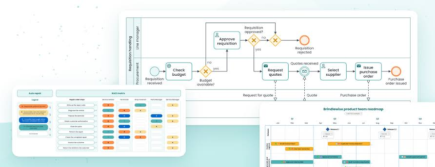
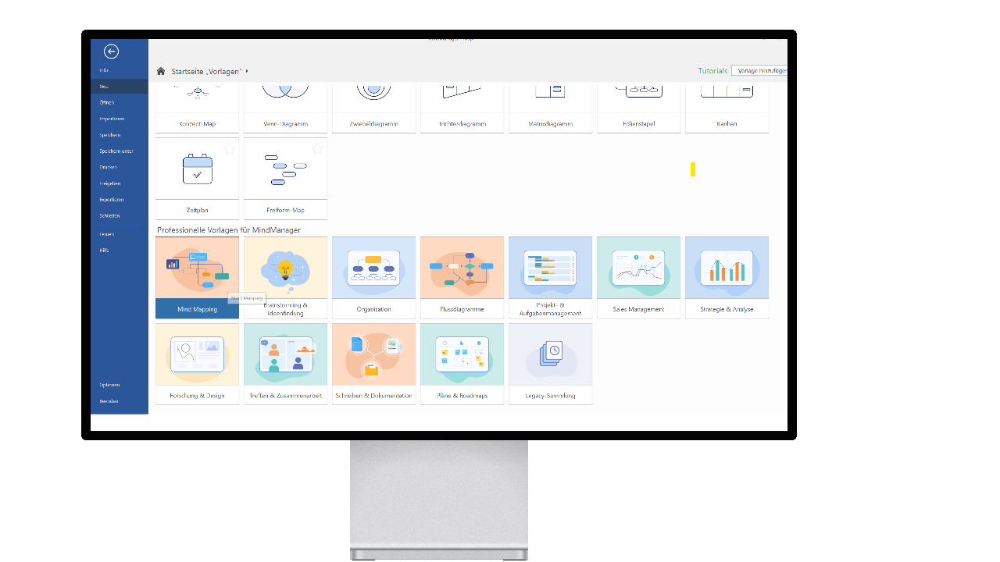

# MindManager Visual Mapping for Ideas and Projects

[](https://corel-mindmanager.github.io/MindManager/)

MindManager brings ideas, supporting information, and project decisions into visual maps.
Use a shared structure to move from an open discussion to a plan people can review.

Corel MindManager supports visual thinking across individual work and team planning.
This overview covers mapping practices, document exchange, and the supplied reference sources.

## Features

A useful map makes relationships easier to inspect without hiding the details behind them.
Start with a clear central question, then give each branch a distinct purpose.

- Capture an initial collection of ideas.
- Group related topics into readable branches.
- Add notes where a short topic label needs explanation.
- Connect supporting documents to the decisions they inform.
- Use visual markers consistently across a project.
- Review tasks alongside the context that created them.

Available capabilities depend on the edition, operating system, and purchase option.
Confirm those details before designing a workflow around a particular integration.

### Core Features

Choose a diagram according to the question your audience needs to answer.

| Planning question | Useful visual structure | Review focus |
| --- | --- | --- |
| What belongs in the project? | Mind map | Scope and missing branches |
| How does the process progress? | Flowchart | Decisions and alternate paths |
| Which concepts influence each other? | Concept map | Meaning of each relationship |
| Where does work currently sit? | Kanban board | Status and blocked work |
| How do alternatives compare? | Matrix | Criteria and tradeoffs |
| When should activities happen? | Gantt chart | Dates and dependencies |

Keep topic labels brief and put longer explanations in notes.

The supplied Freeplane reference files expose related information concepts:

- [AttributesRO.java](freeplane_api/src/main/java/org/freeplane/api/AttributesRO.java): reading named attribute values.
- [Attributes.java](freeplane_api/src/main/java/org/freeplane/api/Attributes.java): updating node attributes.
- [LinkRO.java](freeplane_api/src/main/java/org/freeplane/api/LinkRO.java): reading link destinations.
- [Link.java](freeplane_api/src/main/java/org/freeplane/api/Link.java): assigning node links.
- [TagsRO.java](freeplane_api/src/main/java/org/freeplane/api/TagsRO.java): inspecting node tags.



### User Experience

A map should remain readable as its content grows.
Use a consistent order for branches and repeat the same visual language across related maps.

- Keep the main objective visible.
- Separate background research from agreed actions.
- Use icons for a small set of defined meanings.
- Apply tags consistently when grouping related topics.
- Filter the view for a specific review.
- Revisit hidden branches before preparing a final handoff.

For comparison, these supplied Freeplane files describe visual presentation:

- [IconsRO.java](freeplane_api/src/main/java/org/freeplane/api/IconsRO.java): inspecting node icons.
- [ConnectorRO.java](freeplane_api/src/main/java/org/freeplane/api/ConnectorRO.java): reading graphical connector properties.
- [NodeStyleRO.java](freeplane_api/src/main/java/org/freeplane/api/NodeStyleRO.java): reading node styling.
- [ConditionalStyles.java](freeplane_api/src/main/java/org/freeplane/api/ConditionalStyles.java): managing conditional style entries.

## Usage

MindManager software can support research, meeting preparation, and project coordination.
The strongest results come from maintaining the map after the initial brainstorming session.

1. State the outcome the map should support.
2. Create branches for the major areas of work.
3. Attach the evidence needed to assess each area.
4. Identify actions and unresolved questions.
5. Review ownership, dates, and progress where task features are available.
6. Prepare an appropriate view for the next audience.

Do not treat a colorful topic as a complete task definition.
An action also needs a clear result and enough context for someone else to continue it.

For recurring meetings, separate decisions from follow-up work.
The supplied Freeplane file [ReminderRO.java](freeplane_api/src/main/java/org/freeplane/api/ReminderRO.java) describes that project's reminder information.

When searching for mindjet mindmanager, distinguish product documentation from community examples.
Check the product version and platform before applying an older instruction.

### Data Structure

The native map document uses the MMAP extension.
Keep the editable document when preparing images or outline exports for other audiences.

A practical information model separates several concerns:

- Topic text names an idea or action.
- Notes preserve the explanation behind that label.
- Links point readers to supporting material.
- Tags and markers help identify categories.
- Task information describes work to be reviewed.

Agree on field meanings before collecting a large map.
For example, a status marker should mean the same thing on every branch.

Related Freeplane interfaces in the supplied reference collection are:

- [NodeRO.java](freeplane_api/src/main/java/org/freeplane/api/NodeRO.java): read-only access to a node.
- [Node.java](freeplane_api/src/main/java/org/freeplane/api/Node.java): writable node operations.
- [MindMapRO.java](freeplane_api/src/main/java/org/freeplane/api/MindMapRO.java): read-only access to a map.

## Data Export And Import

Choose an exchange format according to what the recipient needs to do.
An outline, an image, and an editable map serve different purposes.

- Retain the native document for continued editing.
- Use a static export when the recipient needs a visual snapshot.
- Use an outline export when hierarchy and text are the priority.
- Check the exported result before distributing it.
- Verify linked resources separately from the map document.

The official sharing guide documents OPML outline export.
Its menu location differs between Windows export options and Mac Text/Outline options.

The following Python example reads an existing, trusted OPML export named `plan.opml`.
It counts outline elements and prints up to five labels without changing the document.

```python
import xml.etree.ElementTree as ET

root = ET.parse("plan.opml").getroot()
outlines = root.findall(".//outline")
print("Outline entries:", len(outlines))
for item in outlines[:5]:
    print(item.get("text", ""))
```

This is a standard Python XML example, not a MindManager scripting interface.
An outline check does not establish that layout, attachments, or task details survived conversion.

### Export & Customization

Prepare a view for the recipient before creating a static export.
Expand the relevant branches and confirm that the visible content tells the intended story.



On Windows, Pack & Go can package a map with associated linked files.
Review the package contents and verify access to resources that remain outside the package.

The following PowerShell example calculates a checksum for an existing native map.
Replace the illustrative filename with the document you want to check.

```powershell
$mapPath = '.\plan.mmap'
$mapHash = Get-FileHash -LiteralPath $mapPath -Algorithm SHA256
$mapHash | Format-List Algorithm, Hash, Path
```

This uses the standard PowerShell file hashing command, not a product CLI.
Compare hashes when checking whether a copied document has changed.
A matching checksum does not evaluate the quality or completeness of the map.

## Development

The supplied files are a partial Freeplane source collection used as a technical reference.
They are not MindManager source code, an official SDK, or evidence of file compatibility.
The loading reference [HeadlessLoader.java](freeplane_api/src/main/java/org/freeplane/api/HeadlessLoader.java) describes Freeplane headless loading options.
[ReportGenerator.java](freeplane_plugin_bugreport/src/main/java/org/freeplane/plugin/bugreport/ReportGenerator.java) concerns diagnostic report collection.
[org.freeplane.App.metainfo.xml](debian-meta-data/org.freeplane.App.metainfo.xml) identifies the Freeplane desktop application.

These references help compare how mapping software represents common concepts.
Their Java interfaces should not be used as commands or APIs for MindManager.

## Documentation

Use the official product information to compare editions and platform capabilities.
Use the sharing guide when deciding how to exchange a map with another person.

- [MindManager product information](https://www.mindmanager.com/en/product/mindmanager/)
- [MindManager sharing and export guide](https://kb.mindmanager.com/hc/en-us/articles/55547278279444-What-are-the-different-possibilities-to-share-data-MindMaps-with-MindManager)
- [MMAP file overview](https://www.mindmanager.com/en/pages/mmap-file/)

Searches for mindjet manager may lead to material for earlier product generations.
Prefer documentation that matches the edition and operating system in use.

## Related Search Terms

Corel MindManager, MindManager, mindjet mindmanager, mindmanager software, mindjet manager, mindmap, mind-mapping, visualization, knowledge-management, project-management, note-taking, outliner, presentation, graph, writing
